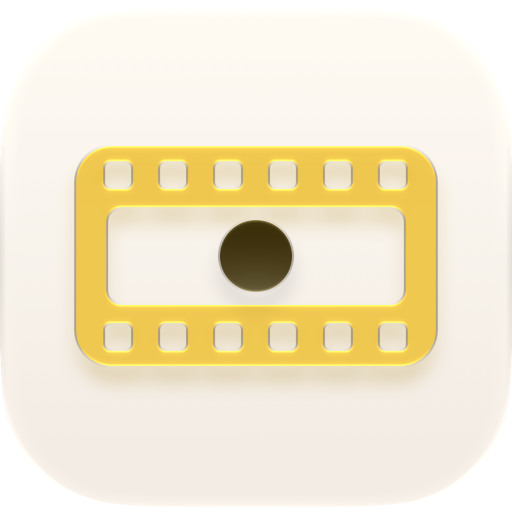
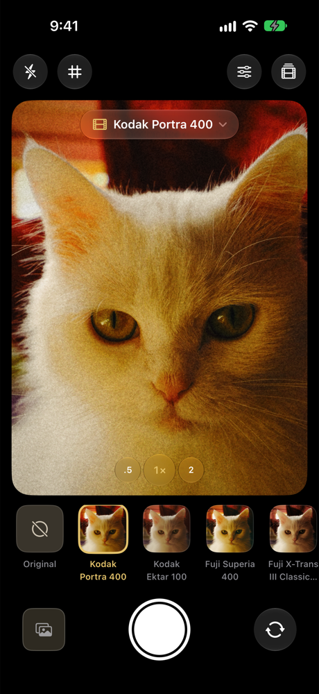

<p align="center">
  
</p>

<h1 align="center">Film Camera</h1>

<p align="center">
  A native iOS camera that shoots through real film emulation LUTs, rendered live with Metal.
</p>

<p align="center">
  
</p>

## Features

- **Live film preview.** Every camera frame runs through a Metal pipeline: exposure and white balance, the film's 3D LUT, then tone, color and film effects. Full-resolution photos go through the same shaders, so the saved photo matches the viewfinder.
- **Around 300 film stocks** from the [Film-Luts](https://github.com/YahiaAngelo/Film-Luts) collection: color negative, slide, black & white, instant, cinema print and Fuji X-Trans simulations. Browse and search them, download one or all of them for offline use, and arrange the ones you use in your film strip.
- **Works offline from the first launch.** Eight popular stocks are built in, along with the full catalog.
- **Film effects:**
  - Grain: two-octave, re-seeded every frame, with a soft-light response so highlights stay clean
  - Glow and halation
  - Vignette and fade
- **Adjustments:** exposure, contrast, highlights, shadows, saturation, warmth, tint and film strength. They're shown in a Liquid Glass sheet that keeps the viewfinder visible and live.
- **Camera controls:** lens switching (0.5×/1×/2×/telephoto), pinch to zoom, tap to focus and expose, flash, grid, front camera.
- **Native iOS 27 design:** SwiftUI with Liquid Glass controls, and a layered Icon Composer app icon.

## Requirements

- Xcode 27 or later
- iOS 27 or later, iPhone
- The Metal Toolchain component, which is needed to compile the shaders:
  ```sh
  xcodebuild -downloadComponent MetalToolchain
  ```

## Getting started

1. Clone the repository and open `Film Camera.xcodeproj`.
2. In **Signing & Capabilities**, select your own development team. The project ships with the maintainer's team ID.
3. Run the **Film Camera** scheme on an iPhone.

The simulator has no camera, so debug builds feed a still sample scene through the same pipeline. That lets you work on the UI and the look in the simulator. The sample image is left out of device builds.

Run the tests with:

```sh
xcodebuild test -project "Film Camera.xcodeproj" -scheme "Film Camera" \
  -destination "platform=iOS Simulator,name=iPhone 18 Pro"
```

## How it works

```
Film Camera/
├── Rendering/   Metal shaders, FilmRenderer and the .cube LUT parser
├── Camera/      AVCaptureSession, photo capture and saving
├── Library/     Film catalog, downloads and offline storage
├── Models/      Film and adjustment models
└── Views/       SwiftUI screens (camera, film library, adjustments)
```

The pipeline in [`FilmShaders.metal`](Film%20Camera/Rendering/FilmShaders.metal) has three stages:

1. **`filmGrade`** (compute): exposure and white balance in linear light, then trilinear sampling of the film's 3D LUT, then highlights/shadows, contrast, saturation and fade.
2. **`filmBright`** (compute): quarter-resolution highlight extraction, blurred with `MPSImageGaussianBlur` for glow and halation.
3. **`filmComposite`** (fragment): glow, halation, vignette and grain, plus an aspect-fill crop for the preview.

The preview uses BGRA frames from `AVCaptureVideoDataOutput`. Photos are captured as uncompressed BGRA at up to 12 MP and processed through the same pipeline. They're saved as HEIC with the original EXIF and orientation metadata. Preview rotation comes from `AVCaptureDevice.RotationCoordinator`, because front and back sensors can be mounted differently.

LUTs are standard `.cube` files. The catalog and LUTs are downloaded from the Film-Luts repository and stored in Application Support.

## Credits

- Film LUTs: [Film-Luts](https://github.com/YahiaAngelo/Film-Luts), a collection of [G'MIC](https://gmic.eu) film emulation LUTs. See that repository for its disclaimer and terms.
- Color palette: shared with [Film Simulator](https://github.com/YahiaAngelo/Film-Simulator), the sibling app for editing photos.

Film stock names are trademarks of their respective owners. They are used only to describe the look each LUT emulates. This project is not affiliated with or endorsed by Kodak, Fujifilm, Ilford, Polaroid or any other manufacturer.

## Privacy

Film Camera collects no data. See [PRIVACY.md](PRIVACY.md).

## License

[MIT](LICENSE)
